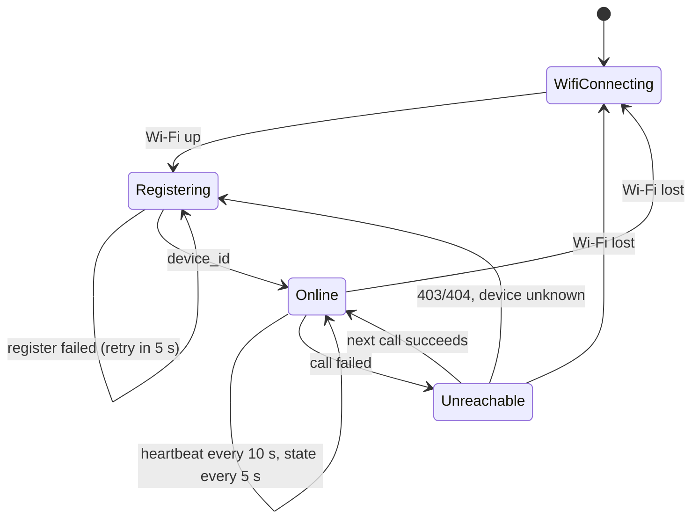

# ESP32-S3 status display: technical guide

This guide turns a 2.8-inch ESP32-S3 touch board into a **physical member of a
Cami Fleet**: it registers with its own certificate, sends heartbeats, goes
offline on the dashboard when you unplug it, and shows on its own screen what
the control plane decided for it, including *why* a model was skipped.

It covers the hardware, the protocol the board speaks, the firmware's design,
step-by-step setup on Windows, a demo script, and troubleshooting.

- Firmware: [`firmware/esp32-display/`](../firmware/esp32-display/)
- Control-plane side: [`control-plane/internal/api/devicehttp/`](../control-plane/internal/api/devicehttp/devicehttp.go)

---

## 1. What the board does, and what it does not

| It does | It does not |
|---|---|
| Register under its certificate's name, with labels and hardware facts | Run a model: no Rust agent, no LiteRT-LM |
| Heartbeat every 10 s; the dashboard marks it offline 30 s after the last one | Stream telemetry (there is nothing to measure) |
| Poll its own state every 5 s and draw it | Answer "Ask a device" questions (those stay pending) |
| Get **skipped** by deployments whose requirements it does not meet, and show the reason | Hold a deployment open: one that reaches it is reported `failed`, with the reason |
| Show fleet-wide counts on a second screen (tap to switch) | See other devices' names, labels or models |

A model needs gigabytes of RAM; this board has 512 KB of SRAM. So its role in
a demo is the part of the system that is about **decisions**: targeting by
label, requirement checks, desired state on reconnect, offline detection, and
per-device identity, all visible on a screen on the desk.

### What you see

```
 Device view                      Fleet view (tap)
┌──────────────────────────┐     ┌──────────────────────────┐
│ CAMI FLEET          ● ○  │     │ CAMI FLEET          ○ ●  │
│ ┌──────────────────────┐ │     │ ┌──────────────────────┐ │
│ │        ONLINE        │ │     │ │        ONLINE        │ │
│ └──────────────────────┘ │     │ └──────────────────────┘ │
│ esp32-display-1          │     │ DEVICES                  │
│ location=desk            │     │ ┌─────┐ ┌─────┐ ┌─────┐  │
│ type=esp32-display       │     │ │  3  │ │  1  │ │  4  │  │
│ ──────────────────────── │     │ │onln │ │offln│ │total│  │
│ NEWEST DEPLOYMENT FOR    │     │ └─────┘ └─────┘ └─────┘  │
│ THIS DEVICE              │     │ DEPLOYMENTS              │
│ gemma-4-e2b              │     │ ┌─────────┐ ┌─────────┐  │
│ SKIPPED                  │     │ │ 1 in pr.│ │ 2 compl.│  │
│ needs 2048 MB RAM,       │     │ ├─────────┤ ├─────────┤  │
│ device has 1 MB          │     │ │ 1 failed│ │ 0 rolled│  │
│                          │     │ └─────────┘ └─────────┘  │
│ heartbeat 4 s ago -52 dBm│     │ heartbeat 4 s ago -52 dBm│
└──────────────────────────┘     └──────────────────────────┘
```

The pill at the top is the link state: **CONNECTING WI-FI** and
**REGISTERING** (amber), **ONLINE** (green), **UNREACHABLE** (red; the screen
then shows the board's IP, the control-plane address and the last error). The
RGB LED mirrors it: blue while starting, green online, red unreachable.

---

## 2. Hardware

The board is LCDWIKI's **ES3C28P** (ES3N28P without touch), sold by diymore and
others as a "Xiaozhi" AI display. Facts read from the unit on COM7 with
`esptool flash_id`:

| | |
|---|---|
| Chip | ESP32-S3 rev 0.2, dual-core Xtensa LX7 @ 240 MHz, Wi-Fi 2.4 GHz + BLE |
| Flash | 16 MB, quad SPI |
| PSRAM | none: the chip reports no embedded PSRAM (some listings say N16R8; this unit reports none) |
| USB | native USB Serial/JTAG (VID 303A, PID 1001), appears as `USB Serial Device (COMx)` |
| Screen | 2.8" IPS, 240 × 320, **ILI9341V** over 4-wire SPI |
| Touch | capacitive, **FT6336G** over I2C at `0x38` |
| Also on board | ES8311 audio codec + mic + speaker header, one WS2812-style RGB LED, microSD, Li-Po charger, BOOT and RESET buttons |

### Pin map

From the vendor's pin table, cross-checked with Xiaozhi's
`freenove-esp32s3-display-2.8-lcd` board config. In the firmware:
[`include/board.h`](../firmware/esp32-display/include/board.h).

| Function | GPIO | Notes |
|---|---|---|
| LCD SCLK / MOSI / MISO | 12 / 11 / 13 | SPI3 host |
| LCD CS / DC | 10 / 46 | |
| LCD reset | — | tied to EN: the panel resets with the chip |
| LCD backlight | 45 | high = on, PWM-dimmable |
| Touch SDA / SCL | 16 / 15 | shared with the ES8311 codec |
| Touch RST / INT | 18 / 17 | INT unused: the firmware polls |
| RGB LED | 42 | one addressable LED |
| BOOT button | 0 | low while pressed; also switches views |
| Audio amp enable | 1 | low = on; the firmware drives it high (off) |

Panel settings that matter: **color inversion on** (it is an IPS panel; without
it every color is its negative) and a 20 MHz SPI clock, the one Xiaozhi's
driver uses for this panel.

---

## 3. Architecture

```
 Control-plane host (docker compose)                     ESP32-S3 display
 ┌──────────────────────────────────────────┐            ┌─────────────────────┐
 │ control plane                            │            │ network task (core 0)│
 │   :9090 gRPC, mTLS, TLS 1.3 ◀── agents   │            │   register          │
 │   :8443 device HTTPS, mTLS, TLS 1.2+ ◀───┼── Wi-Fi ───┤   heartbeat  10 s   │
 │          │                               │  JSON over │   state       5 s   │
 │          ▼ same checks, same code        │  HTTP/1.0  │   ack (failed)      │
 │   grpc.Server: RegisterAs, HeartbeatAs,  │            │        │ Snapshot   │
 │   AckAs, Authorize, Reconcile            │            │        ▼ (mutex)    │
 │          │                               │            │ UI loop (core 1)    │
 │   Postgres: devices, device_deployments  │            │   touch, draw, LED  │
 └──────────────────────────────────────────┘            └─────────────────────┘
```

The board only dials out, like every device in the fleet. It needs no open
port.

### Why not gRPC

The Rust agent talks gRPC over HTTP/2 with TLS 1.3. On this board that is the
wrong fit:

- **TLS version.** Arduino-ESP32 2.0.x ships mbedTLS 2.28, which speaks TLS up
  to 1.2. The gRPC listener requires TLS 1.3.
- **Weight.** gRPC needs HTTP/2 framing, HPACK and protobuf on top of TLS.
  Each piece fits on an ESP32-S3, but the board only needs four request/response calls.
- **Streams.** `WatchDeployments` and `WatchTasks` are long-lived server
  streams. A display gains nothing from them: polling every 5 s is fast enough
  for a screen, and a closed socket costs nothing between polls.

### The device HTTPS API is not a second trust model

[`devicehttp`](../control-plane/internal/api/devicehttp/devicehttp.go) is a
second listener on the control plane (`:8443`) with the same rules:

- **Same certificates.** It requires a client certificate signed by the fleet
  CA (`tls.RequireAndVerifyClientCert`), loaded from the same `CERT_DIR` by the
  shared [`mtls`](../control-plane/internal/mtls/mtls.go) package.
- **Same identity.** The caller is the certificate's common name. It is read
  from the TLS connection, never from the request body.
- **Same code path.** Each endpoint calls the gRPC server's own logic with that
  caller: `RegisterAs`, `HeartbeatAs`, `AckAs`, `Authorize`, `Reconcile`. The
  gRPC methods are thin wrappers over the same functions. A rule added there
  applies here too.
- **Only the TLS floor differs.** This listener accepts TLS 1.2, for
  mbedTLS. The gRPC listener stays at TLS 1.3. Set
  `DEVICE_HTTPS_PORT=off` to disable the listener.

### Desired state without a stream

A gRPC agent gets its desired deployment when it connects: `WatchDeployments`
calls `Reconcile`, then sends whatever is pending. The board has no stream, so
**`GET /device/v1/state` reconciles on every poll**, then reads the result.
`Reconcile` is idempotent: it inserts a `device_deployments` row only if none
exists, so repeated polls change nothing.

A deployment created while the board is registered, even while it is
unplugged, is recorded for it at creation: the REST API targets every device
whose labels match, online or not. Reconciling covers the other case. A board
that registers after the deployment was created, or registers again with new
labels, gets the newest matching deployment on its first poll. That is the
same answer an agent gets when it connects.

---

## 4. Device HTTPS API reference

Base URL `https://<control-plane-host>:8443`. Every request needs the
device's client certificate. Bodies are JSON. Errors are plain text with the
status code below.

| Endpoint | gRPC equivalent | Body → response |
|---|---|---|
| `POST /device/v1/register` | `Register` | `RegisterRequest` → `{"device_id"}` |
| `POST /device/v1/heartbeat` | `SendHeartbeat` | `{"device_id"}` → `{"server_ts_unix"}` |
| `POST /device/v1/ack` | `AckDeployment` | `{"deployment_id","device_id","status","error_msg"}` → `204` |
| `GET /device/v1/state?device_id=…` | *(none; replaces the watch stream)* | → state, below |

### Register

```json
POST /device/v1/register
{
  "device_name": "esp32-display-1",
  "labels": {"location": "desk", "type": "esp32-display"},
  "agent_version": "cami-display/0.1.0",
  "arch": "xtensa",
  "os": "esp-idf",
  "mem_total_mb": 1,
  "accelerators": []
}

200 {"device_id": "3f1c…"}
```

`device_name` must equal the certificate's common name (`403` otherwise).
Registering again under the same name returns the same ID and updates labels
and hardware.

The hardware fields are what deployment requirements are checked against:

- `mem_total_mb` is internal heap plus PSRAM, rounded **up** to whole MiB, and
  never less than 1. The control plane treats `0` as "unknown" and would not
  hold the board to a `min_mem_mb` requirement. Reporting 1 means a
  `min_mem_mb: 2048` deployment skips it with an honest reason.
- `accelerators` is empty, so a deployment requiring `cpu`, `gpu` or `npu`
  skips it too.
- `arch` is `xtensa`, so `"arch": ["aarch64", "x86_64"]` skips it.

### Heartbeat

```json
POST /device/v1/heartbeat
{"device_id": "3f1c…"}

200 {"server_ts_unix": 1793052000}
```

`403` means the ID does not belong to this certificate. If the control plane's
database was reset, the ID is unknown and you get `403` too. Either way the
firmware registers again.

### State

```json
GET /device/v1/state?device_id=3f1c…

200 {
  "server_ts_unix": 1793052005,
  "device": {
    "id": "3f1c…", "name": "esp32-display-1", "status": "online",
    "labels": {"location": "desk", "type": "esp32-display"},
    "current_model_id": null, "arch": "xtensa", "os": "esp-idf",
    "mem_total_mb": 1, "accelerators": [], "last_seen_at": "…", "…": "…"
  },
  "assignments": [
    {"deployment_id": "9a…", "model_id": "gemma-4-e2b", "status": "skipped",
     "error_msg": "needs 2048 MB RAM, device has 1 MB", "updated_at": "…"}
  ],
  "fleet": {
    "devices": {"online": 3, "offline": 1},
    "deployments": {"completed": 2, "in_progress": 1, "failed": 1}
  }
}
```

`assignments` holds this device's five newest deployments, newest first, with
this device's status on each: `pending`, `downloading`, `verifying`,
`running`, `failed`, `skipped` or `rolled_back`. `error_msg` carries the skip
or failure reason.

`fleet` holds counts only. A device learns how many devices and deployments are
in each state, never which ones.

### Ack

```json
POST /device/v1/ack
{"deployment_id": "9a…", "device_id": "3f1c…", "status": "failed",
 "error_msg": "display-only device: an ESP32-S3 status screen has no model runtime"}

204
```

A device may report only `downloading`, `verifying`, `running` or `failed`
(`400` otherwise). The deployment must target this device (`404` otherwise).

### Status codes

| Code | Meaning |
|---|---|
| `401` | No verified client certificate (normally the TLS handshake fails before this) |
| `403` | The name or device ID does not belong to the calling certificate |
| `400` | Bad JSON, or a status a device may not report |
| `404` | Device not found, or the deployment does not target this device |

You can call the API from a PC with the board's certificate, which is handy
for debugging. In PowerShell, `curl.exe` is the real curl:

```powershell
curl.exe --cacert certs\ca.crt --cert certs\device.crt --key certs\device.key `
  --resolve control-plane:8443:127.0.0.1 `
  -X POST https://control-plane:8443/device/v1/register `
  -H "Content-Type: application/json" `
  -d '{\"device_name\":\"esp32-display-1\",\"labels\":{\"location\":\"desk\"}}'
```

---

## 5. Security model

| Concern | How it is handled |
|---|---|
| Who is calling | The certificate's common name, from the verified TLS chain |
| Impersonating another device | Register checks the name against the certificate. Every other call checks that the device ID belongs to it (`Authorize`). |
| Server impersonation | The board verifies the server certificate against the fleet CA and the name `CP_TLS_NAME` |
| What a device can read | Its own record, its own deployments, fleet-wide counts |
| Secrets on the board | Wi-Fi password and the device's private key, compiled into flash |
| A lost board | That board's key can act only as that board: register it, heartbeat it, fail its own deployments |

**Why the board checks a name, not the IP.** The board connects to
`CP_ADDRESS` (for example `192.168.1.20`) but verifies the certificate against
`CP_TLS_NAME` (`control-plane`). mbedTLS 2.28 matches only DNS names in a
certificate, not IP addresses. `scripts/gen-certs.sh` always puts
`DNS:control-plane` in the server certificate, so you do not have to re-issue
it with your LAN IP, as the Raspberry Pi guide requires.

**Flash is readable.** Anyone holding the board can dump its flash over USB
and get the key and the Wi-Fi password. For a demo that is fine. For anything
else, enable ESP32 flash encryption and secure boot, or keep the key in the
digital-signature peripheral. All three are ESP-IDF features outside this
firmware.

**No revocation.** As with agents, the fleet has no certificate revocation
list yet. Cutting off a lost board means re-issuing the CA. This is a known
limitation of the whole project, not of this board.

---

## 6. Firmware design

| File | Role |
|---|---|
| [`platformio.ini`](../firmware/esp32-display/platformio.ini) | Pinned toolchain: espressif32 6.9.0 (Arduino-ESP32 2.0.17), LovyanGFX 1.2.7, ArduinoJson 7.2.1, `huge_app` partitions |
| [`include/board.h`](../firmware/esp32-display/include/board.h) | Pin map |
| `include/secrets.h` | Wi-Fi, control-plane address, device name, labels, CA, certificate, key. Generated, git-ignored. |
| [`src/main.cpp`](../firmware/esp32-display/src/main.cpp) | Tasks, the network state machine, the LED, input |
| [`src/fleet_client.cpp`](../firmware/esp32-display/src/fleet_client.cpp) | mTLS HTTP client and JSON for the four endpoints |
| [`src/ui.cpp`](../firmware/esp32-display/src/ui.cpp) | Panel driver config and the two screens |
| [`src/touch.cpp`](../firmware/esp32-display/src/touch.cpp) | FT6336 tap detection |
| [`src/snapshot.h`](../firmware/esp32-display/src/snapshot.h) | What the network task hands the UI |
| [`tools/make_secrets.py`](../firmware/esp32-display/tools/make_secrets.py) | Writes `secrets.h` from the certificate files |

### Two tasks

A TLS handshake with an RSA-2048 client key takes the ESP32-S3 a noticeable
fraction of a second. If the UI waited on it, taps would be dropped. So:

- **Network task**, pinned to core 0 next to the Wi-Fi stack, with a 16 KB stack
  for mbedTLS. It makes every blocking call and writes the results into a
  `Snapshot`, under a FreeRTOS mutex.
- **Arduino loop**, on core 1, every 50 ms. It copies the snapshot, reads the touch
  controller and the BOOT button, updates the LED, and redraws.

### Network state machine



| Constant | Value | Why |
|---|---|---|
| Heartbeat | 10 s | Same as the agent. The control plane marks a device offline after 30 s without one, checking every 15 s. |
| State poll | 5 s | Fast enough that a deployment shows on screen within seconds |
| Retry after a failure | 5 s | Avoids hammering a control plane that is down |
| Response timeout | 10 s | One slow call must not stall the loop for long |

### One connection per request

Each call opens a TLS connection, sends an **HTTP/1.0** request and reads
until the server closes. With HTTP/1.0 the server never uses chunked
encoding, so the client can read the body without parsing chunks. That adds
three handshakes every 10 s, which is acceptable on a LAN. Keep-alive would
save them, at the cost of handling half-closed sockets.

### Why the board fails deployments that reach it

A deployment whose selector matches the board's labels and that has no
requirements it fails would sit `pending` on the board forever. That keeps the
deployment `in_progress` forever and blocks it from completing. So when the
board sees a `pending` assignment, it acks `failed` with *"display-only device:
an ESP32-S3 status screen has no model runtime"*, exactly as an agent does
when its runtime cannot load a model. The dashboard and the board's screen
both show the reason.

To keep the board out of model rollouts:

- Give it labels your model selectors do not use (`type=esp32-display`), or
- Put requirements on real deployments (`min_mem_mb`, `accelerator`, `arch`).
  The board is then *skipped*, which does not count as a failure.

### Drawing

The screen is redrawn only when something on it changes. A signature string of
every visible field is compared with the last one drawn. The footer
("heartbeat 4 s ago") is redrawn on its own when its text changes. Without
PSRAM a full-screen sprite (150 KB at 16 bits per pixel) would compete with
mbedTLS for heap, so drawing goes straight to the panel. A full redraw takes
about 60 ms at 20 MHz.

Touch needs no calibration. The firmware reads only the touch-point count from
register `0x02` and treats a lift as a tap. The BOOT button does the same, so
the touchless ES3N28P works too.

### Memory

Built with PlatformIO, the firmware uses about 47 KB of static RAM out of
320 KB, and about 0.96 MB of flash out of the 3 MB app partition. At run time
Wi-Fi takes about 50 KB and each TLS session about 40 to 50 KB while it is
open.

---

## 7. Setup (Windows)

You need Docker Desktop for the control plane, Python 3, and the board on USB.
The commands are PowerShell, run from the repository root unless stated.

### Step 1: issue the board's certificate and start the stack

Add the board to the devices `cert-gen` issues certificates for:

```powershell
Copy-Item .env.example .env        # if you have no .env yet
Add-Content .env "EXTRA_DEVICE_NAMES=esp32-display-1"
docker compose up -d --build
```

`cert-gen` runs on every `up`, keeps existing certificates, and issues new ones
for names it has not seen. The control plane now also listens on `8443`:

```powershell
docker compose logs control-plane | Select-String "device HTTPS"
# ... device HTTPS API listening (mTLS, TLS 1.2+) addr=:8443
```

### Step 2: copy the certificate out of the volume

```powershell
New-Item -ItemType Directory -Force firmware\esp32-display\certs | Out-Null
docker run --rm `
  -v cami-fleet_certs:/certs:ro `
  -v "${PWD}\firmware\esp32-display\certs:/out" `
  alpine sh -c "cp /certs/devices/esp32-display-1/ca.crt /certs/devices/esp32-display-1/device.crt /certs/devices/esp32-display-1/device.key /out/"
Get-ChildItem firmware\esp32-display\certs   # ca.crt, device.crt, device.key
```

`firmware/esp32-display/certs/` is git-ignored. It holds this board's private
key and nothing else.

### Step 3: find the address the board will use

The board must reach the PC running Docker over Wi-Fi:

```powershell
Get-NetIPAddress -AddressFamily IPv4 | Where-Object { $_.InterfaceAlias -match "Wi-Fi|Ethernet" } |
  Select-Object InterfaceAlias, IPAddress
```

Use the address on the same network as the board (for example `192.168.1.20`).
The board's Wi-Fi is **2.4 GHz only**. If your router splits bands, join the
2.4 GHz network.

Allow port 8443 in through the Windows firewall (from an elevated PowerShell):

```powershell
New-NetFirewallRule -DisplayName "Cami Fleet device API" -Direction Inbound -Protocol TCP -LocalPort 8443 -Action Allow
```

### Step 4: generate `secrets.h`

```powershell
cd firmware\esp32-display
python tools\make_secrets.py --certs certs --ssid "YourWifi" --password "YourPassword" `
  --address 192.168.1.20 --name esp32-display-1 --labels "location=desk,type=esp32-display"
```

`--name` must be the name you issued the certificate for. Labels use the same
`key=value,key=value` format as the agent's `DEVICE_LABELS`.

### Step 5: install PlatformIO

Any PlatformIO works: the VS Code extension, or the CLI in its own virtual
environment:

```powershell
python -m venv $env:USERPROFILE\.platformio\penv
& $env:USERPROFILE\.platformio\penv\Scripts\python.exe -m pip install platformio
Set-Alias pio $env:USERPROFILE\.platformio\penv\Scripts\pio.exe
```

The first build downloads the ESP32-S3 toolchain (several hundred MB) and takes
about 10 minutes. Later builds take about 30 s.

### Step 6: back up the Xiaozhi firmware (optional, recommended)

Flashing replaces whatever the board runs now. To be able to go back, dump all
16 MB first. This takes a few minutes over USB:

```powershell
pio pkg exec -p tool-esptoolpy -- esptool.py --chip esp32s3 --port COM7 read_flash 0 0x1000000 xiaozhi-backup.bin
```

Restore later with
`esptool.py --chip esp32s3 --port COM7 write_flash 0 xiaozhi-backup.bin`, or
flash a fresh Xiaozhi build from its project page.

### Step 7: build, flash, watch

```powershell
pio run -t upload --upload-port COM7
pio device monitor -p COM7
```

Expected serial output:

```
[display] esp32-display-1, touch found
[fleet] registered as esp32-display-1, device id 3f1c...
```

The screen goes amber (CONNECTING WI-FI, then REGISTERING), then green
(ONLINE). The board is on the dashboard at <http://localhost:5173> as
`esp32-display-1`, `xtensa`, `esp-idf`, 1 MB.

---

## 8. Demo script

Set these once:

```powershell
$api = "http://localhost:8080/api"
$h = @{ "X-Api-Key" = "changeme"; "Content-Type" = "application/json" }
$sha = (Get-Content artifacts\sample-gemma-4-e2b.tar.gz.sha256).Split(" ")[0]
```

**1. A model the board cannot hold is skipped, with the reason.**

```powershell
$body = @{
  model_id = "gemma-4-e2b"
  artifact_url = "http://control-plane:8080/artifacts/sample-gemma-4-e2b.tar.gz"
  artifact_sha256 = $sha
  tag_selector = @{ location = "desk" }
  requirements = @{ min_mem_mb = 2048 }
} | ConvertTo-Json
(Invoke-RestMethod -Method Post "$api/deployments" -Headers $h -Body $body).targeting
```

The response's `targeting.skipped` lists the board's ID with *"needs 2048 MB
RAM, device has 1 MB"*. Within 5 s the screen shows `SKIPPED` and the same
reason.

Swap the requirement for `@{ accelerator = "npu" }` or `@{ arch = @("aarch64") }`
to show a different skip reason.

**2. A model with no requirements reaches it and fails honestly.** Run the same
request without the `requirements` line. The screen shows `FAILED` with
*"display-only device: ... has no model runtime"*. Because the board was the
only target, the deployment's status is `failed`.

**3. Offline detection and catch-up.** Unplug the board. After about 30 s the
dashboard shows it offline. Create a deployment for `location=desk` while it is
unplugged: `targeting.targeted` still lists the board, because offline devices
are targeted too, and its row stays `pending`. Plug it back in. Within a few
seconds of `ONLINE` it shows the new deployment and reports it.

**4. Fleet at a glance.** Tap the screen. The fleet view counts devices and
deployments by state. The two simulated devices from the quick start count too.

**5. The control plane goes away.** `docker compose stop control-plane`: the pill
turns red (UNREACHABLE) and shows the TLS error, and the LED goes red.
`docker compose start control-plane`: the board is green again on its next
call.

**6. Identity.** With the board's own certificate, try to register as another
device. Run this from `firmware\esp32-display`:

```powershell
curl.exe --cacert certs\ca.crt --cert certs\device.crt --key certs\device.key `
  --resolve control-plane:8443:127.0.0.1 `
  -X POST https://control-plane:8443/device/v1/register `
  -d '{\"device_name\":\"device-barcelona-1\",\"labels\":{}}'
# device_name must match the client certificate's common name   (HTTP 403)
```

The key proves which device is calling. A request cannot claim to be another
device.

---

## 9. Troubleshooting

The screen shows the last error in full while the board is not online. The
serial monitor prints it too.

| Symptom | Cause and fix |
|---|---|
| Stuck on CONNECTING WI-FI | Wrong SSID or password, or a 5 GHz-only network. Regenerate `secrets.h`. |
| `TLS ... failed: X509 - Certificate verification failed` | The CA in `secrets.h` is not the one that signed the server certificate, for example after recreating the Docker volumes. Repeat steps 2 and 4. |
| `TLS ... failed: SSL - A fatal alert message was received from our peer` | The server rejected the board's certificate: not signed by the current CA, or not a client certificate. Repeat steps 1, 2 and 4. |
| `TLS ... failed:` with no reason, or a connect or timeout message | Nothing answers on `CP_ADDRESS:8443`. Check the address, the firewall rule, and that the control plane logs `device HTTPS API listening`. |
| `HTTP 403: device_name must match ...` | `--name` differs from the certificate's common name |
| `cannot resolve ...` | `CP_ADDRESS` is a hostname the network does not resolve; use the IP |
| Colors are negatives of what they should be | Flip `cfg.invert` in `src/ui.cpp` |
| Red and blue are swapped | Flip `cfg.rgb_order` in `src/ui.cpp` |
| Image mirrored or upside down | Change `lcd.setRotation(0)` (0 to 3), or `cfg.offset_rotation` |
| Taps do nothing, serial says `touch not found` | The board is the touchless ES3N28P, or the touch cable is loose. The BOOT button switches views. |
| Upload: `Unable to verify flash chip connection` | Usually a one-off right after the previous firmware reset. Run it again. If it persists, hold BOOT, tap RESET, release BOOT, and upload. |
| No serial output | The monitor must use the board's own USB port (COM7 here). `ARDUINO_USB_CDC_ON_BOOT=1` routes `Serial` there. |
| On the dashboard, "Ask a device" never answers | Expected: the board has no agent or model to answer with |

---

## 10. Extending it

- **More screens.** Add a value to `View`, a draw function in `ui.cpp`, and a
  case in `Ui::render`. Every field in `/device/v1/state` is already parsed into
  `FleetState`.
- **Landscape.** `lcd.setRotation(1)` gives 320 × 240. The layout constants in
  `ui.cpp` assume portrait.
- **Smoother drawing.** On a module with PSRAM, render into an `LGFX_Sprite`
  in PSRAM and push it in one go.
- **Fewer handshakes.** Switch the client to HTTP/1.1 keep-alive and reuse one
  `WiFiClientSecure`. Handle the server closing idle connections after 60 s.
- **Sound.** The ES8311 codec and speaker are unused. A short tone on
  `failed` would carry across a room.
- **OTA updates.** `huge_app.csv` has no second app slot. Switch to a 16 MB
  partition table with two OTA slots to update over Wi-Fi.
